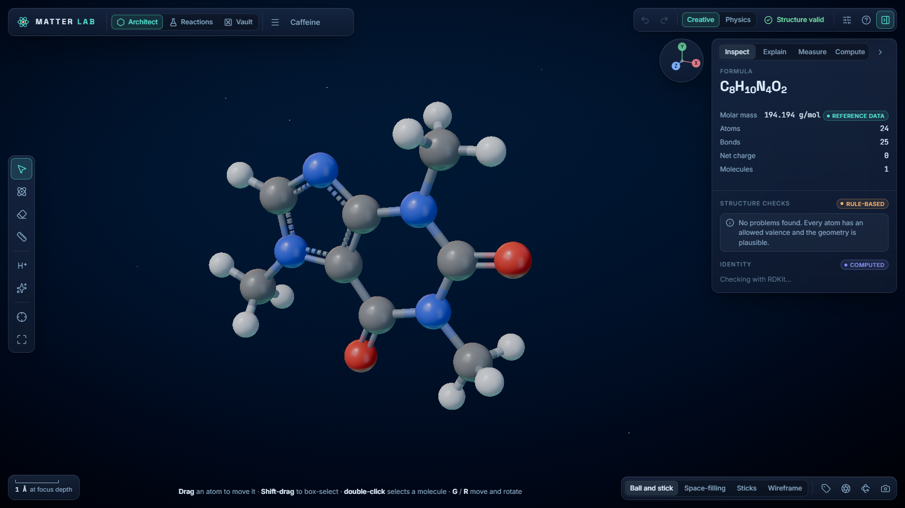

# MATTER LAB

An interactive 3D laboratory for atoms, molecules and reactions that runs in the browser. You build
structures atom by atom on a GPU-rendered stage, change protons, neutrons and electrons, validate,
optimise and measure what you built, look at computed orbitals, densities and potentials, run
reaction experiments from sourced data, and keep candidate structures with their evidence.

Every value on screen is labelled by what it is: reference data, computed, rule-based, illustrative,
user input or unsupported. Where an engine cannot treat a system it says so and shows nothing in
its place.



## Quick start

```powershell
git clone https://github.com/sahil-lab/matter-lab.git
Set-Location matter-lab
.\env.ps1          # only needed if `node --version` is older than 22.12 (see Requirements)
npm install
npm run dev        # http://127.0.0.1:5273/
```

On first start the application opens with caffeine on stage; afterwards it restores the last
session. Nothing else has to be running: every calculation the application offers is done in the
browser. [docs/examples/README.md](docs/examples/README.md) lists things to try.

## What is here

| Part | State |
| --- | --- |
| Molecular Architect: build, edit, measure, undo, import and export, five representations including skeletal, surfaces | works, tested |
| Atomic Forge: all 118 elements, isotopes from 3,383 evaluated nuclides, charges, a view of the nucleus | works, tested |
| Validation and identifiers: rule-based checks and RDKit (WebAssembly); search of the built-in library; PubChem look-up; 3D models from SMILES | works, tested |
| Geometry optimisation with the Universal Force Field, with comparison, replay and explanation | works, tested |
| Electronic structure: restricted Hartree-Fock, STO-3G, closed-shell molecules of H to Ar; orbitals, density, electrostatic potential, cutting planes | works, tested, within those limits |
| Reaction Laboratory: balancing, thermodynamics for 175 species, eight sourced gas-phase rate laws, timeline, graphs, saved and reproducible records | works, tested; the 3D chamber is illustrative and says so |
| Discovery Vault: candidates, catalogue searches, an evidence ladder, reports | works, tested; stored in the browser |
| Science service: FastAPI, PostgreSQL, RDKit, xTB, PySCF jobs, catalogue, Excel workbook | built and tested on its own; **not connected to the interface** |

Not built: WebGPU (the renderer is WebGL 2), ray-marched volume rendering, a desktop package, any
Rust or C++ layer, computed reaction trajectories, and the connection between the interface and the
science service. The complete list, feature by feature, is in
[docs/feature-status.md](docs/feature-status.md); what each result can and cannot be trusted for is
in [docs/scientific-limitations.md](docs/scientific-limitations.md).

## Requirements

- **Node.js 22.12 or newer** (24 was used) with its bundled npm.
- **Windows.** Everything here was developed and run on Windows with PowerShell. The npm scripts
  themselves are not tied to Windows, but nothing has been run anywhere else, `env.ps1` is a
  PowerShell script, and the browser-test configuration asks for Direct3D.
- **Microsoft Edge** for the browser tests (it ships with Windows, so nothing is downloaded). Set
  `PW_CHANNEL=chrome` to use Chrome, or `PW_CHANNEL=bundled` after `npx playwright install chromium`.
- **Docker Desktop**, only for the science service.
- **Python 3.12 with RDKit**, only to regenerate the example molecules (see Reference data).

`env.ps1` points the current PowerShell window at a suitable Node: it looks at `MATTERLAB_NODE_DIR`,
then at the `node` on the path, then at the versions installed under nvm for Windows, and puts the
project's own tools (`vite`, `vitest`, `tsc`, `playwright`) on the path. It changes nothing outside
that window. If your default Node is new enough you do not need it.

## Commands

From the repository root:

| Command | What it does |
| --- | --- |
| `npm install` | Installs all workspaces |
| `npm run dev` | Development server at http://127.0.0.1:5273/ (the port is fixed; 5173 is deliberately not used) |
| `npm run build` | Type-checks and builds the application into `apps/web/dist` |
| `npm run preview` | Serves that build at http://127.0.0.1:4273/ |
| `npm run typecheck` | `tsc --noEmit` for every workspace |
| `npm test` | Unit tests of the packages and the application (Vitest) |
| `npm run test:e2e` | Browser tests against the development server; it starts one if none is running |
| `npm run test:e2e:build` | The same browser tests against a fresh production build |
| `npm run screenshots` | Captures `docs/screenshots` again from the running application |
| `npm run benchmark` | Measures rendering and responsiveness and writes `docs/benchmarks` |
| `npm run data:elements`, `data:isotopes`, `data:species` | Rebuild the generated reference data |

### Tests

- **Unit tests.** `npm test` runs every package and the pure parts of the application. One project
  at a time: `vitest run --project core` (or `forcefield`, `quantum`, `reactions`, `web`). The
  force-field and quantum packages include performance tests with absolute time limits
  (`test/performance.test.ts`). On a busy or battery-powered machine they can fail while everything
  else passes; run that file alone (`vitest run packages/quantum/test/performance.test.ts`) before
  concluding anything.
- **Browser tests.** They drive the real application in headless Edge with real mouse and keyboard
  input, on the real GPU, one test at a time. The whole suite takes the better part of an hour. To
  run part of it, from `apps\web`:

  ```powershell
  playwright test editor chemistry            # files whose names contain these words
  playwright test quantum -g "cutting plane"  # tests whose titles contain these words
  ```

  Two tests query the real PubChem; they skip themselves, saying so, when PubChem cannot be reached.
- **The built application.** `npm run test:e2e:build` builds into `apps/web/dist-e2e` with the test
  hook switched on (`apps/web/.env.e2e`) and runs the browser tests against it. The normal
  production build exposes no test hook.
- **Science service.** `docker compose -p matterlab run --rm science pytest` (see below).

Which suites passed, when, and what could not be run is recorded in
[docs/development-notes.md](docs/development-notes.md).

### Screenshots and benchmark

`npm run screenshots` runs the scripts `apps/web/e2e/*.shots.ts`; one set at a time from `apps\web`
with `playwright test -c playwright.shots.config.ts gallery` (or `science`, `quantum`, `vault`,
`laptop`). `npm run benchmark` takes about ten minutes and needs mains power and an otherwise idle
machine to mean anything. Its report is
[docs/benchmarks/render-benchmark.md](docs/benchmarks/render-benchmark.md), and
[docs/benchmarks/README.md](docs/benchmarks/README.md) says how to read it and how far a busy or
battery-powered machine moves the numbers.

## The science service

A separate Python service with its own database. The application does not use it yet; it can be
started, tested and called on its own.

```powershell
docker compose -p matterlab up -d --build             # PostgreSQL and the service; first build about 1.1 GB
curl.exe http://127.0.0.1:8787/health
docker compose -p matterlab run --rm science pytest   # its test suite, about 7 minutes
docker compose -p matterlab down                      # stop; the database volume is kept
```

The API is at http://127.0.0.1:8787 (interactive documentation at `/docs`), PostgreSQL at
`127.0.0.1:55432`; both are bound to the loopback interface only. The database credentials in
`docker-compose.yml` are development defaults, not secrets, and can be overridden from the
environment. The service has no authentication and is meant for local development. More in
[services/science/README.md](services/science/README.md) and [docs/api/README.md](docs/api/README.md).

## Deployment

The application is a static site. `npm run build` writes it to `apps/web/dist` (about 21 MB with
source maps, of which the RDKit WebAssembly file is 7 MB); any web server that serves that folder
at the root of a site will do, and `npm run preview` does it locally. The build assumes the path
`/`, so serving it from a sub-folder needs Vite's `base` option. It needs no backend. Nothing has
been deployed anywhere, and there is no desktop package.

The science service is a local development stack: it has no authentication and its ports are bound
to the loopback interface. Do not expose it as it is.

## Reference data

The element table, the nuclide table, the example molecules and the species models of the Reaction
Laboratory are generated files (`*.generated.ts`); they are not edited by hand.

| Data | Source snapshot | Rebuild |
| --- | --- | --- |
| 118 elements | `tools/data/sources/pubchem-periodic-table.json`, `rdkit-periodic-table.json` | `npm run data:elements` |
| 3,383 nuclides | `tools/data/sources/iaea-ground-states.csv` | `npm run data:isotopes` |
| Species models | `tools/data/sources/pubchem-3d-conformers.json` | `npm run data:species` |
| 16 example molecules | computed with RDKit | `.venv\Scripts\python.exe tools\data\build_examples.py` |

The three npm scripts rebuild from the snapshots and need no network. To refresh a snapshot from
its source first, add `-- --fetch` (for example `npm run data:isotopes -- --fetch`). The
Python tool needs a virtual environment that is not part of the repository:
`python -m venv .venv`, then `.venv\Scripts\pip install rdkit`. The force-field, quantum and
reaction packages keep their own sources, generators and reference fixtures; their READMEs describe
them.

Sources, versions, retrieval dates and licence notes travel with the data and are shown in the
application. The reaction package keeps short IUPAC excerpts under
[CC BY-NC-SA 2.5](https://creativecommons.org/licenses/by-nc-sa/2.5/) and NIST WebBook excerpts
to make every number traceable. The project owner confirmed permission to redistribute the NIST
excerpts for this public publication. Their existing notices and attribution are retained; this
does not relicense third-party material or grant blanket commercial reuse rights. See
[packages/reactions/README.md](packages/reactions/README.md).

## Layout

```
apps/web/              the application (React, Three.js, Vite) and its browser tests (e2e/)
packages/core/         shared model: scene, elements, nuclides, validation, file formats
packages/forcefield/   Universal Force Field
packages/quantum/      restricted Hartree-Fock, fields, isosurfaces
packages/reactions/    stoichiometry, thermodynamics, kinetics, the experiment pipeline
services/science/      Python service (FastAPI) with its tests
db/migrations/         PostgreSQL schema
tools/data/            builders and source snapshots of the reference data
docs/                  documentation, screenshots, benchmark reports, example experiments
```

## Documentation

| Document | Content |
| --- | --- |
| [docs/architecture.md](docs/architecture.md) | How the parts fit together |
| [docs/feature-status.md](docs/feature-status.md) | Implemented, partial and unsupported features, against the specification |
| [docs/scientific-limitations.md](docs/scientific-limitations.md) | What each result is and how far it can be trusted |
| [docs/development-notes.md](docs/development-notes.md) | How it was built, what was verified and when, known problems of the environment |
| [docs/api/README.md](docs/api/README.md) | The HTTP API of the science service and the APIs of the packages |
| [docs/benchmarks/README.md](docs/benchmarks/README.md) | Measured performance and how to read it |
| [docs/examples/README.md](docs/examples/README.md) | Example experiments and molecules, and things to try |
| [docs/screenshots/](docs/screenshots) | The running application |
| Package READMEs: [core](packages/core/README.md), [forcefield](packages/forcefield/README.md), [quantum](packages/quantum/README.md), [reactions](packages/reactions/README.md), [science service](services/science/README.md) | Methods, validation against reference programs, limits |

## Troubleshooting

- **`npm install` or `npm run dev` complains about the Node version.** Run `.\env.ps1` in that
  window first, or install Node 22.12 or newer.
- **The port is in use.** The development server insists on 5273 and the preview on 4273. Stop
  whatever holds the port; another copy of this server is the usual cause.
- **The application shows an error about something that the source plainly defines, or changes do
  not appear.** The development server's file watcher can miss changes while the computer sleeps.
  Stop and restart `npm run dev`.
- **Browser tests fail with "element is not stable", or a test takes far longer than its time
  limit.** The computer went into standby during the run. Keep it awake for the duration and run
  the affected tests again.
- **`docker compose up` hangs at "Network … Creating", or containers stay in "Created".** The Docker
  engine is stuck; this happened on the development machine. Restart Docker Desktop, then run the
  command again. Nothing in this repository can repair it.
- **No Microsoft Edge.** Set `PW_CHANNEL` as described under Requirements.
