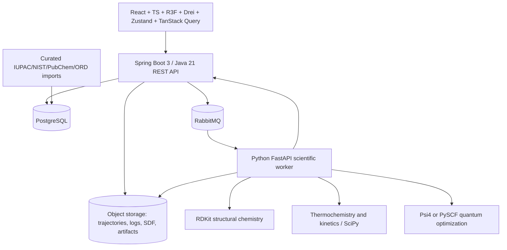

# MATTER LAB v1 — Implementation-Ready Technical Specification

**Version:** 1.0 | **Date:** 2026-11-13 | **Status:** Build specification

## 0. Executive contract

MATTER LAB is an interactive React/Three.js scientific workbench for authoring atoms, isotopes, ions and molecules; constructing multi-component virtual experiments; computing supported structural, thermodynamic, kinetic and quantum-mechanical outputs; and storing candidate discoveries with auditable provenance.

**Non-negotiable truth rule:** The interface may draw any *hypothetical* structure, but may never claim its stability, reaction product, drug activity, or novelty without a corresponding defensible calculation or cited experimental reference. Every calculated quantity must include method, units, conditions, evidence level and limitations. A failed or unsupported calculation must not be converted to a plausible-looking result.

### v1 in scope
1. 118-element periodic catalog, associated element properties and curated isotope data.
2. Editable atom model: proton, neutron and electron counts; element/ion/isotope derived from counts; warnings on unsupported or unstable configurations.
3. 3D molecular editor: place/move/delete atoms, edit bonds and stereochemical annotations where supported; undo/redo; explicit-H controls; import/export SMILES, MolBlock/SDF for valid structures and JSON for arbitrary draft graphs.
4. RDKit structural validation, molecular formula, canonical SMILES, InChIKey (where available), exact and substructure search.
5. Multi-ingredient reaction chamber, roles (reactant/reagent/catalyst/solvent/inert), measured quantities, temperatures, pressure, duration, and supported reaction-library lookup.
6. Thermochemistry for **balanced, specified reactions with phase-matched reference enthalpies**; elementary reaction kinetics for *user-provided or referenced mechanisms and rate constants*.
7. Geometry optimization of supported small molecules using constrained CPU quantum chemistry; optional fast preoptimization; provenance and convergence logging.
8. Experiment save/reopen, candidate discovery lifecycle, immutable run outputs and searchable history.
9. Source-aware explanation panel showing inputs, mathematical model, result, uncertainty, assumptions and limitations.
10. XLSX import/export for small/curated catalogs and experiment notebooks, with CSV/Parquet and database for bulk collections.

### Explicitly out of scope for v1
- A universal unknown-product generator or accurate arbitrary-reaction prediction.
- Exact simulation of nuclear transmutation, nuclear reactors, nuclear weapon physics, radiation source design, or particle-by-particle nuclear reactions; the editor only displays isotope identity and linked reference data.
- Full pharmaceutical synthesis planning or operational procedures for restricted compounds; v1 may represent documented safe reactions and molecular property data.
- Full fluid dynamics, catalyst surface microkinetics, experimental drug efficacy, patient safety, or proven novel scientific discovery.
- Real-time ab initio simulation of large proteins/materials on the client.

## 1. System architecture



**Deployment:** `web` static UI; `api` Spring Boot; `worker` Python separate container; `db` PostgreSQL; `queue` RabbitMQ; `minio` S3-compatible storage for local dev. Enforce authenticated jobs, resource quotas, input caps and non-root isolated workers without outbound network by default. Run quantum tools as subprocesses in isolated containers, not inside web request handlers. Worker sends progress/status via event publishing; API exposes SSE.

**Monorepo:**
```
matter-lab/
  apps/web/src/{app,features/atom-editor,features/molecule-editor,
    features/reaction-chamber,features/discovery,components/3d,
    components/explanation,lib/api,stores,types}
  apps/api/src/main/java/com/matterlab/{catalog,molecule,experiment,
    simulation,discovery,auth,common}
  services/science/{app,chemistry,thermo,kinetics,quantum,tests}
  packages/contracts/{openapi,schemas}
  data/{reference-manifests,seed}
  infra/{docker,compose,db-migrations}
  docs/{adr,science-validation,sources}
```

## 2. Frontend / UX component specifications

**Shell:** `<LabShell>` with resizable panels: left `<CatalogSidebar>`; center `<ThreeViewport>`; right `<PropertyInspector>`; bottom `<TimelineAndResults>`; floating `<ScientificExplanationPanel>`; top `<ProjectToolbar>` and `<SimulationJobIndicator>`.

**Features:**
- `<PeriodicTable>` 118 entries, symbol/search/filter, stable source metadata.
- `<AtomForge>` proton/neutron/electron sliders and validated integer controls; derives element as `Z=protons`, isotope `A=protons+neutrons`, ion charge `q/e=protons-electrons`; guards Z outside 1..118 with "unknown/unsupported element" rather than inventing symbol; shows element properties and uncertainty.
- `<MoleculeCanvas>` React Three Fiber instancing for atoms/bonds, orbital display as optional *illustrative* mode, perspective/orthographic cameras, drag placement, measurement ruler, snap-to-bond, marquee select, keyboard navigation, accessible table editor, bond orders single/double/triple/aromatic, explicit atom-map IDs, undo/redo using command log.
- `<StructureInspector>` formula, formal charge, stereochemistry flags, warnings, canonical identifiers, geometric coordinates, validation status.
- `<ReactionChamber>` list of N ingredients; roles; amount with unit; condition inputs (temperature K, pressure Pa, duration s, solvent); selected supported reaction template or explicit reaction equation; never guess reaction from unordered ingredients.
- `<JobRunPanel>` method choice (lookup, thermo, kinetics, optimize), cost estimate (qualitative), progress, cancel, convergence, failure, logs.
- `<EnergyDiagram>` reaction enthalpy or optimization energy vs iteration; axes with proper units; no manufactured activation barrier.
- `<ConcentrationPlot>` species concentration vs time from a documented rate law/ODE model.
- `<ExplanationPanel>` summary, equation, quantitative results, assumptions, referenced inputs, sources, accuracy status, confidence/uncertainty where supported, alternatives, warnings, data lineage.
- `<ExperimentNotebook>` saved draft, frozen run, notes, search, version history, export.
- `<CandidateVault>` candidate validation ladder; source/search timestamp; never label automatically "new substance discovered".

**Accessibility/performance:** WCAG 2.2 AA target; keyboard-only editing fallback; reduced-motion toggle; 60 fps targeted for 200-atom editing scene on reasonable desktop; object instancing, selective subscriptions, no React re-render per animation frame; large molecules require LOD and explicit limits. Accurate geometry is stored in angstroms independent of scene units.

**Client state:** Zustand for transient editing (`selectedAtoms`, `draftGraph`, `undoStack`, `viewSettings`); TanStack Query for server resources/jobs; never persist results solely in local browser state. Patches use optimistic version (`If-Match` or revision field) to prevent silent overwrites.

## 3. Core canonical data types

```ts
type EvidenceLevel = 'EXACT_IDENTITY'|'REFERENCE_MEASURED'|'MODEL_CALCULATED'|'ILLUSTRATIVE'|'UNVERIFIED';
type AtomNode = {
  id: string; protons: number; neutrons: number; electrons?: number;
  formalCharge?: number; isotopeMassNumber?: number;
  x: number; y: number; z: number; // Angstrom
};
type BondEdge = { id: string; a: string; b: string;
  order: 1|2|3|'AROMATIC'; stereo?: string };
type MolecularDraft = { id: string; atoms: AtomNode[]; bonds: BondEdge[];
  electronModel: 'GLOBAL_TOTAL'|'ATOM_ASSIGNMENT_DRAFT';
  totalCharge: number; spinMultiplicity?: number;
  revision: number; validationStatus: 'DRAFT'|'INVALID'|'VALID'|'UNSUPPORTED' };
type Ingredient = { moleculeId: string; role: 'REACTANT'|'REAGENT'|'CATALYST'|'SOLVENT'|'INERT';
  amount: {value: number; unit: 'mol'|'mmol'|'g'|'mL'}; purityFraction?: number };
type ReactionConditions = {temperatureK: number; pressurePa?: number; durationS?: number;
  solventMoleculeId?: string; volumeL?: number };
type SimulationStatus = 'QUEUED'|'RUNNING'|'SUCCEEDED'|'FAILED'|'CANCELLED'|'UNSUPPORTED';
type ResultQuantity = {name: string; value: number; unit: string;
  standardUncertainty?: number; evidence: EvidenceLevel; sourceIds: string[] };
```

**Physical modeling nuance:** Proton and neutron count identifies a nuclide; RDKit sanitization operates on *chemical graphs*, not physical nucleus validation. Bound electrons are not reliably assignable per atom in general molecules: electron counts edited on isolated atoms must become a clearly indicated bookkeeping or formal-charge proposal once bonded. Use total molecular charge and spin multiplicity for quantum calculations, not atom-by-atom electron beads.

## 4. PostgreSQL schema (first migration)

Use UUID primary keys, `created_at`, `updated_at`, `created_by`, and a `revision`/optimistic-lock column on mutable records. Representative DDL:

```sql
CREATE TABLE element (
  atomic_number SMALLINT PRIMARY KEY CHECK (atomic_number BETWEEN 1 AND 118),
  symbol VARCHAR(3) NOT NULL UNIQUE,
  name TEXT NOT NULL,
  standard_atomic_weight TEXT, -- intervals/uncertainty, not falsely exact float
  period SMALLINT, grp SMALLINT, category TEXT,
  source_id UUID, dataset_version TEXT NOT NULL
);
CREATE TABLE isotope (
  id UUID PRIMARY KEY, atomic_number SMALLINT NOT NULL REFERENCES element(atomic_number),
  mass_number INTEGER NOT NULL, neutron_number INTEGER NOT NULL,
  atomic_mass_u NUMERIC, half_life_seconds NUMERIC, stability_label TEXT,
  source_id UUID, UNIQUE (atomic_number,mass_number),
  CHECK(mass_number = atomic_number + neutron_number)
);
CREATE TABLE molecule (
  id UUID PRIMARY KEY, canonical_smiles TEXT, inchi_key TEXT,
  formula TEXT, net_charge INTEGER, spin_multiplicity INTEGER,
  molecular_graph JSONB NOT NULL, structure_status TEXT NOT NULL,
  created_by UUID, revision INTEGER NOT NULL DEFAULT 1,
  created_at TIMESTAMPTZ NOT NULL DEFAULT now(), updated_at TIMESTAMPTZ NOT NULL DEFAULT now()
);
CREATE INDEX molecule_inchikey_idx ON molecule(inchi_key);
CREATE TABLE reference_source (
  id UUID PRIMARY KEY, provider TEXT NOT NULL, title TEXT NOT NULL,
  url TEXT, doi TEXT, license TEXT, accessed_at TIMESTAMPTZ,
  dataset_version TEXT, citation_json JSONB
);
CREATE TABLE reaction_reference (
  id UUID PRIMARY KEY, equation_json JSONB NOT NULL,
  conditions_json JSONB, product_json JSONB,
  evidence_status TEXT NOT NULL, source_id UUID REFERENCES reference_source(id)
);
CREATE TABLE experiment (
  id UUID PRIMARY KEY, owner_id UUID NOT NULL, title TEXT NOT NULL,
  draft_json JSONB NOT NULL, revision INTEGER NOT NULL DEFAULT 1,
  created_at TIMESTAMPTZ NOT NULL DEFAULT now(), updated_at TIMESTAMPTZ NOT NULL DEFAULT now()
);
CREATE TABLE simulation_run (
  id UUID PRIMARY KEY, experiment_id UUID NOT NULL REFERENCES experiment(id),
  method TEXT NOT NULL, status TEXT NOT NULL, input_snapshot JSONB NOT NULL,
  method_version TEXT NOT NULL, model_parameters JSONB NOT NULL,
  output_summary JSONB, logs_object_key TEXT, artifacts_json JSONB,
  failure_code TEXT, started_at TIMESTAMPTZ, completed_at TIMESTAMPTZ,
  created_at TIMESTAMPTZ NOT NULL DEFAULT now()
);
CREATE TABLE discovery_candidate (
  id UUID PRIMARY KEY, owner_id UUID NOT NULL, molecule_id UUID REFERENCES molecule(id),
  title TEXT NOT NULL, status TEXT NOT NULL, novelty_checks JSONB NOT NULL DEFAULT '[]',
  supporting_run_ids UUID[] NOT NULL DEFAULT '{}', notes TEXT,
  created_at TIMESTAMPTZ NOT NULL DEFAULT now()
);
```

Additional production tables: `users`, `experiment_ingredient`, `thermo_reference_value` (phase, temperature, pressure, basis, uncertainty, source), `kinetic_model`, `catalog_import`, `candidate_status_event`, `structure_search_index`, `audit_event`, `background_job`, `dataset_release`. Introduce structure fingerprints using RDKit/Postgres cartridge only after benchmarking licensing/deployment; otherwise compute in worker and store fingerprints for indexed prefiltering.

## 5. Excel schema / integration

XLSX workbook `MatterLab_Catalog_Template.xlsx` contains sheets:

| Sheet | Columns (required first) | Validation |
|---|---|---|
| Elements | atomic_number, symbol, name, atomic_weight_display, group, period, category, source_uri, source_version | 118 unique Z=1..118; no made-up weights |
| Isotopes | atomic_number, mass_number, neutron_number, half_life_s, stability_label, source_uri | A=Z+N; isotope may lack measured half-life |
| Compounds | local_id, name, smiles, inchi_key, formula, charge, status, source_uri | RDKit parsed, source provenance, no naive dedup by name |
| Catalysts | local_id, name, compound_id, type, source_uri, notes | role is contextual; not inherent to all reactions |
| Solvents | local_id, name, compound_id, density_g_ml, source_uri | conditions and temperature for measured properties |
| Reactions | reaction_id, equation, reactant_ids, product_ids, conditions_json, evidence_status, source_uri | atom and charge conservation; catalyst role separate |
| Experiments | experiment_id, title, created_at_utc, conditions_json, input_json, status | version and owner |
| Discoveries | candidate_id, name, structure_id, status, checked_sources_json, created_at_utc | never equate nonmatch with novelty |
| Calculations | run_id, experiment_id, method, method_version, result_json, units, evidence_level, artifact_uri | immutable after completion |
| Sources | source_id, provider, title, doi, url, license, accessed_at_utc, dataset_version | require traceability |

**Import:** upload XLSX max 10 MB in v1, workbook schema-version cell, preview per-row failures, normalize units, verify duplicates, dry-run, transactionally commit valid rows only when user accepts. Formula cells should not execute; read values only, sanitize strings against Excel formula injection on exports (`=`, `+`, `-`, `@`). Dedup compounds using standardized structural identity plus charge/stereo/isotope policy, not just InChIKey blindly. Export curated selection (100k rows max to keep responsiveness). Full catalogs: paginated API and CSV/Parquet bulk export, not giant XLSX workbook.

## 6. API contract (`/api/v1`)

All bodies JSON unless file operations; UUID identifiers; ISO-8601 timestamps; errors RFC 9457 Problem Details with `type,title,status,detail,instance,code,traceId`. Include `requestId`, auth scopes, rate limits and idempotency keys on creates/jobs.

| Method + path | Request | Response |
|---|---|---|
| `GET /elements` | `?q=&page=&size=` | paginated element cards |
| `GET /elements/{z}` | — | element + source |
| `GET /elements/{z}/isotopes` | — | isotope page |
| `POST /molecules/validate` | `MolecularDraft` | `valid`, errors/warnings, formula, charge, identifiers; unsupported status |
| `POST /molecules` | `MolecularDraft` | molecule ID + revision |
| `GET /molecules/{id}` | — | molecule with graph |
| `PATCH /molecules/{id}` | patch + `If-Match` | updated revision / 409 conflict |
| `POST /molecules/search` | `mode: EXACT|SUBSTRUCTURE|SIMILARITY`, structure, limit | match IDs, scores, source |
| `POST /experiments` | title, chamber state | ID + revision |
| `GET /experiments/{id}` | — | saved editable experiment |
| `PATCH /experiments/{id}` | state + revision | updated experiment |
| `POST /experiments/{id}/runs` | job type, frozen conditions, model params | `202 Accepted`, jobId, status URL |
| `GET /runs/{id}` | — | status, progress, result if ready |
| `GET /runs/{id}/events` | SSE | state/progress messages |
| `POST /runs/{id}/cancel` | — | cancellation requested |
| `GET /runs/{id}/explanation` | — | structured explanation, sources, caveats |
| `POST /candidates` | structure ID, note | candidate `USER_CREATED` |
| `POST /candidates/{id}/novelty-check` | requested datasets | queued search job |
| `GET /candidates/{id}` | — | status and evidence history |
| `POST /catalog/import` | XLSX multipart | import validation preview |
| `POST /catalog/import/{id}/commit` | dry-run token | committed counts |
| `GET /catalog/export` | scope, format XLSX/CSV | streamed artifact |

### Essential request/response examples

`POST /api/v1/molecules/validate`
```json
{
  "atoms": [
    {"id":"o","protons":8,"neutrons":8,"x":0,"y":0,"z":0},
    {"id":"h1","protons":1,"neutrons":0,"x":0.96,"y":0,"z":0},
    {"id":"h2","protons":1,"neutrons":0,"x":-0.24,"y":0.93,"z":0}
  ],
  "bonds": [
    {"id":"b1","a":"o","b":"h1","order":1},
    {"id":"b2","a":"o","b":"h2","order":1}
  ],
  "totalCharge":0,"spinMultiplicity":1,"electronModel":"GLOBAL_TOTAL","revision":1
}
```
Response:
```json
{
  "status":"VALID","formula":"H2O","canonicalSmiles":"O",
  "netCharge":0,"validationEngine":"RDKit","warnings":[],
  "evidence":"EXACT_IDENTITY","limitations":["No claim of energetic stability from graph sanitization"]
}
```

`POST /api/v1/experiments/{id}/runs`
```json
{
  "runType":"THERMOCHEMISTRY",
  "reaction":{"reactants":[{"speciesId":"h2-g","coefficient":2},{"speciesId":"o2-g","coefficient":1}],
    "products":[{"speciesId":"h2o-g","coefficient":2}]},
  "conditions":{"temperatureK":298.15,"pressurePa":100000},
  "method":{"name":"FORMATION_ENTHALPY_SUM","datasetVersion":"nist-curated-v1"}
}
```
Response: `202 Accepted` with `{ "runId":"UUID", "status":"QUEUED", "statusUrl":"/api/v1/runs/UUID" }`.

## 7. Scientific service contracts and algorithms

### 7A. Identity and structure validation
- Derive `Z = protons`, `A = protons + neutrons`, isolated ion's `charge/e = protons-electrons`.
- Reject negative/noninteger counts; label non-118 Z as unsupported in v1; isotope data availability separate from physical existence.
- Build RDKit `RWMol` from requested atomic numbers, isotope mass numbers, bond edges and formal charges. Sanitize; report precise errors. Confirm connected components, aromaticity, valence, isotope, stereochemistry and spin consistency where possible.
- Graph validation *does not* establish that a hypothetical compound is synthesizable, isolable or stable.
- Canonicalize and index identity; differentiate positional isomers, stereoisomers, isotopologues and salts.

### 7B. Thermodynamics
For balanced equations with verified stoichiometry and matched physical phases, at reference conditions:
`ΔrH° = Σ ν_product ΔfH°(product) − Σ ν_reactant ΔfH°(reactant)`.
Where sufficient reference entropy data exist, `ΔrG° = ΔrH° − T ΔrS°` at reference T or more rigorously calculate T-adjusted values using Cp functions. Do **not** extrapolate temperature dependence without valid heat capacity range. Propagate input uncertainties when provided; missing data => `UNSUPPORTED` (no fabricated energy).

### 7C. Kinetics
Given **explicit reaction mechanism** and rate constants, solve `dC/dt = S · v(C,T)` using `scipy.integrate.solve_ivp` with positivity checks, stiff methods when needed, mass conservation validation and solver tolerances surfaced. For an *elementary* step only, allow Arrhenius `k(T)=A exp(-Ea/(RT))` when A, Ea, reaction orders and units are supplied. Mixing chemicals alone is not enough to derive products/rates. Never imply a global reaction stoichiometry is necessarily an elementary rate law.

### 7D. Quantum geometry optimization
- Eligibility gates: supported elements/basis, maximum heavy atoms (default 12), max total atoms (default 24), charge and spin supported, finite coordinates, user-owned quota, resource and walltime limits.
- Optional RDKit ETKDG/MMFF/UFF preoptimization for supported structures; label force-field separately from quantum output.
- Quantum backend: Psi4 (example DFT functional/basis configurable, initially a limited supported profile such as `B3LYP/def2-SVP` after checking backend compatibility); ensure charge/multiplicity consistency and SCF convergence.
- Write optimized XYZ/SDF if conversion is valid, electronic energy in Hartree, geometry changes, method+basis+software version+convergence+time; reject failed SCF or optimization with clear diagnostic.
- Geometry minimum is **not** proof of reaction pathway, lifetime or bulk stability; frequency calculation is a separate optional validation step and may reveal non-minimum stationary points.

### 7E. Reaction lookup
- Accept user-defined reactants, conditions and optional selected reaction template.
- Search curated reaction records by mapped reactant structures, role constraints and conditions; return *documented outcomes* or eligible predefined template predictions with evidence labels.
- Reaction SMARTS transform describes a structural rule; do not treat template products as measured or guaranteed.
- Unsupported combinations return `NO_SUPPORTED_PREDICTION`, plus optional transparent explanation of missing evidence, never an invented product.

### 7F. Candidate novelty checks
State machine: `USER_CREATED -> STRUCTURE_VALID -> DATABASE_CHECKED_NO_MATCH | KNOWN_MATCH | INVALID -> COMPUTATION_SUPPORTED -> RESEARCH_CANDIDATE` (each transition audited). These are **internal screening statuses**, not patent priority, chemical discovery or experimental confirmation. Store exact query, database/dataset version, retrieved matches, timestamps, transformation rules and method logs. A database nonmatch is not a novelty proof.

## 8. Safety, security and scientific integrity

- Strict scientific claim taxonomy: `IDENTITY_FACT`, `EXPERIMENTAL_REFERENCE`, `MODEL_PREDICTION`, `HYPOTHESIS`, `UNSUPPORTED`.
- Block dangerous operational synthesis workflows and nuclear device/process engineering; avoid returning detailed actionable protocols for restricted pharmaceuticals, toxins or weaponizable agents. Molecular visualization, general properties and broad conceptual explanations remain available where appropriate.
- Content review/allowlisting for curated reaction template import; preserve safe educational scenarios. Treat external sources as untrusted data.
- No LLM-generated numeric chemistry answers. Optional explanatory AI may only paraphrase structured solver outputs and must cite their source IDs.
- Authentication/OIDC; per-tenant ownership; signed object URLs; strict file MIME and parser limits; SSE auth; CSRF protections for cookie sessions; dependency pinning and SBOM; audit trails; resource isolation for compute workers.
- Long-running scientific programs must be sandboxed with CPU/memory/time limits, file-size quotas and no privileged host access.

## 9. Testing and release criteria

### Unit tests
- All 118 entries unique and ordered; `Z=8,N=8` maps to oxygen-16; `Z=6,N=8` carbon-14; electron count derives charge correctly; negative counts rejected; unknown Z not assigned existing symbol.
- RDKit parse/valence tests: water valid, methane valid, impossible bonding invalid or explicitly unsupported, disconnected salts preserved; isotope/charge/stereo retained after round-trip.
- Balancing: `2 H2 + O2 -> 2 H2O` conserves H/O and charge; unbalanced equation blocked before energy calculation.
- Thermochemistry: documented `2 H2(g)+O2(g)->2 H2O(l)` near -571.6 kJ at ~298 K (with precise adopted reference values and uncertainty); gas-phase water gives a different value. Tests must not cross phases.
- Kinetics: first-order decay A -> products with `d[A]/dt=-k[A]`, numerical solution within 0.2% of analytic reference at selected times; missing k returns unsupported.
- Quantum: H2 and water converge with documented method/basis; verify geometry within benchmark tolerance and store absolute energy with units. Verify forced timeout/non-convergence fails cleanly.
- XLSX: full element 118-row round-trip, invalid isotope rejected, malicious formula strings escaped, 10MB file rejected, import preview is side-effect free.
- Candidate: local nonmatch never becomes `EXPERIMENTALLY_DISCOVERED`; all status changes audited.

### Integration/E2E
- Save molecular draft -> reload graph positions/charges/bonds -> validate -> run -> SSE -> result/explanation -> export; compare data equality.
- Simulated queue worker crash yields recoverable FAILED/RETRY state; duplicate idempotency key does not enqueue duplicate job; cross-user experiment access forbidden.
- Three.js keyboard edits, undo/redo and drag interactions with Playwright; accessibility and reduced-motion behavior.
- Performance: 200-atom editing viewport smooth on reference desktop, API p95 < 400ms for catalog CRUD (not science jobs), deterministic validation p95 < 2s for supported small structures; report hardware and dataset before promising performance.

**Definition of Done:** (1) all supported chemistry workflows reproducible, (2) units and provenance visible, (3) every failure honest, (4) scientifically reviewed benchmark suite green, (5) no unsupported input silently receives a fictional product.

## 10. Delivery phases with acceptance gates

**P0 — Architecture and repo (1 week):** Docker Compose, CI, API auth, OpenAPI, React shell, science worker health; end-to-end job smoke test.

**P1 — Catalog + Atomic Forge (2–3 weeks):** 118 element seed, isotopes curated, XLSX import/export, integer particle editor, unit tests. Gate: 118 records round-trip, isotopes reconcile.

**P2 — Molecule builder + RDKit (3–4 weeks):** Three.js atom/bond manipulation, graph API, undo/redo, sanitization, exact/substructure search, geometry persistence. Gate: saved water and ethanol structures round-trip; invalid structures honestly flagged.

**P3 — Reaction chamber + model calculations (3–5 weeks):** ingredients/roles, conditions, balanced specified reactions, reference thermochemistry, first-order and simple mass-action kinetics, plot and explanation. Gate: energy/ODE benchmark suite green.

**P4 — Quantum worker (3–5 weeks):** resource-limited Psi4 backend, progress/cancel, convergence and artifact upload, small-molecule reference tests. Gate: H2/H2O optimized and failed jobs handled.

**P5 — Candidate Vault + polish (2–3 weeks):** databases searches, status history, citations, source licenses, exports, secure E2E tests and scientific documentation. Gate: novelty nonmatch safely represented as unverified candidate.

**Planning estimate:** 14–21 engineering weeks for focused v1 implementation, longer for independent scientific validation, full catalog curation and production deployment. Estimates depend on team, infrastructure and features.

## 11. Copy-paste prompts for coding agents

### Agent A — Architecture / platform
> You are the lead software architect for MATTER LAB v1. Read this specification first. Generate a pnpm React TypeScript Vite frontend, Spring Boot 3 Java 21 REST API, Python FastAPI science worker, PostgreSQL, RabbitMQ, MinIO, Docker Compose, CI, health endpoints and OpenAPI definitions. Keep a monorepo with testable modules. Use UUID, structured logs, request IDs, RFC 9457 errors, idempotency keys for simulation creation, auth and resource limits. Implement one full smoke test: web creates a dummy scientific job, worker processes it, API serves terminal result. Never fabricate scientific computation. Deliver code, README, dev scripts, tests and architecture decisions.

### Agent B — Atom editor / Three.js
> Build the MATTER LAB Atomic Forge React R3F editor. Use a canonical editable graph model. Provide 118-element palette, draggable spheres, bond editing, isotope/proton/neutron/electron controls, derived identity/ion charge, realistic labeled orbitals as an optional illustrative visualization, 3D picking, undo/redo and accessible numeric editing fallback. All coordinates are angstroms. In a molecule do not equate locally assigned electron beads to measured electron density; show total charge and formal charges. Use Zustand for draft state, TanStack Query for API. Provide unit and Playwright tests for interaction and save/reload. Do not hardcode fake simulation results.

### Agent C — Chemistry validation and search
> Implement a Python RDKit FastAPI module with `/validate`, `/canonicalize`, `/search/exact`, `/search/substructure`. Convert draft atomic/bond graphs into RDKit molecules, validate supported charges, isotopes and aromaticity, return canonical SMILES, formula, InChIKey if available, warnings/errors, and source/evidence metadata. Distinguish invalid from unsupported; sanitization never proves stability. Write tests covering water, methane, ethanol, aromatic rings, charge, isotope, invalid valence and molecule round-trips. Provide a versioned API schema shared with Java.

### Agent D — Database / Excel / sourcing
> Implement catalog SQL migrations and seed all 118 officially recognized elements with cited reference provenance. Create XLSX template with Elements, Isotopes, Compounds, Catalysts, Solvents, Reactions, Experiments, Discoveries, Calculations, Sources worksheets and exact validation rules from the specification. Support dry-run import, row-level errors, source license/version tracking, selection export, formula-injection escaping and asynchronous bulk exports. Do not invent compound or isotope attributes. Add tests for all 118 entries, duplicate detection, malformed workbooks, and round-trip. Keep PostgreSQL as source of truth; XLSX is interchange only.

### Agent E — Reaction chamber / thermo / kinetics
> Build an experiment editor for multiple components, roles, quantities with units, temperature, pressure and time. Provide reaction-reference lookup and explicit reaction-equation input. Implement atom/charge balancing verification. Thermochemistry: derive reaction enthalpy using phase-matched sourced standard formation enthalpies; reject incomplete reference data. Kinetics: solve a user-provided mass-action mechanism with SciPy solve_ivp and provided constants, enforce species conservation and show solver tolerances. Do not infer product identities or rates from arbitrary mixture alone. Return typed results with units, references, model limits and status; add benchmark unit/integration tests and graphs.

### Agent F — Quantum computation
> Implement an isolated CPU quantum optimization worker for approved small molecules. Verify structures, charge, spin, atom limits and selected basis/method availability before enqueue. Support Psi4 configuration, optional RDKit force-field preoptimization marked separately, geometry optimization with convergence checks, timeout/memory limits, cancel and immutable logs. Output coordinates (angstroms), electronic energy (Hartree), convergence metadata, full input parameters, software version and artifact URI. On non-convergence return FAILED, never successful guessed coordinates. Test H2 and water using documented benchmark references, plus failures.

### Agent G — Scientific explanation and Discovery Vault
> Build a structured explanation renderer driven only by measured reference data or real solver outputs. For each run, display inputs, equations, values with units, uncertainty if known, method/version, source links, assumptions, limitations and any unsupported claims. Implement candidate statuses USER_CREATED, STRUCTURE_VALID, KNOWN_MATCH, DATABASE_CHECKED_NO_MATCH, COMPUTATION_SUPPORTED, RESEARCH_CANDIDATE, INVALID with audited transitions. Search PubChem/local curated catalogs where permitted and record search times, database versions and exact query settings. A no-match is not a scientific discovery and must never produce a triumphant 'new element discovered' claim. Add end-to-end tests and scientific-integrity snapshots.

### Agent H — QA / scientific validation
> Act as a skeptical computational chemist and QA lead. Inspect all scientific claims and verify models, units, phases, charge/atom conservation, method applicability, numerical convergence, uncertainty and benchmark comparisons. Write Python/JUnit/Playwright suites and scientific validation report. Deliberately try invalid valence, unsupported elements, unknown reactant mixtures, isotope mistakes, thermodynamic phase mismatch, unavailable rate constants, optimization timeouts and missing citations. Flag any API that returns unsupported certainty. Do not approve a build until required Definition-of-Done gates pass.

### Agent I — Integration orchestrator
> Integrate agents A–H in this order: architecture -> database -> atom editor -> chemistry services -> reaction calculations -> quantum worker -> discoveries -> scientific QA. Do not change shared API contract without a versioned pull request and OpenAPI generation. Maintain a dependency graph and `docs/adr` decision log. Every PR must have tests, migration plans, concise screenshots if UI, scientific evidence level and limitations. Keep features disabled until backend computation is real and benchmarked. Assemble a runnable local demo, API collection, technical manual and release checklist.

## 12. Trusted references and update policy

- IUPAC periodic table: https://iupac.org/what-we-do/periodic-table-of-elements/
- NIST Chemistry WebBook: https://webbook.nist.gov/ and https://webbook.nist.gov/chemistry/guide/
- PubChem: https://pubchem.ncbi.nlm.nih.gov/ and https://pubchem.ncbi.nlm.nih.gov/docs/pug-rest
- RDKit: https://www.rdkit.org/docs/
- Psi4: https://psicode.org/ and https://psi4.github.io/psi4docs/
- Open Reaction Database schema: https://docs.open-reaction-database.org/en/latest/schema.html
- ASE: https://ase-lib.org/
- SciPy: https://docs.scipy.org/doc/scipy/reference/generated/scipy.integrate.solve_ivp.html

Import scripts must record provider, access date, dataset release/version, URL/DOI, license and data quality. Verify terms and redistribution rights before bulk importing any provider dataset. Claims from data sources must be cited in explanation views, with temperature, phase and method matched to each quantity.

## 13. Initial engineer's first 10 tickets

1. Initialize monorepo with CI, lints, service contracts and Docker Compose.
2. Add `element`, `isotope`, `reference_source` migrations and 118-element seed with source metadata.
3. Implement XLSX generation + dry-run import with source/version validation.
4. Build React lab shell, three-panel layout, theme, accessible controls.
5. Build Atom Forge isolated atom inspector + derived Z/A/charge.
6. Implement R3F draft graph editor, bond manipulation and undo/redo.
7. Create RDKit validation and exact-search service and contract tests.
8. Add experiment and immutable simulation-run persistence + asynchronous queue.
9. Build supported thermochemistry benchmark, structured explanation and plot.
10. Add small-molecule quantum optimization worker with resource caps and genuine convergence reporting.

**Priority:** Scientific integrity > reproducibility > UX correctness > visual effects > breadth of modeled chemistry.
